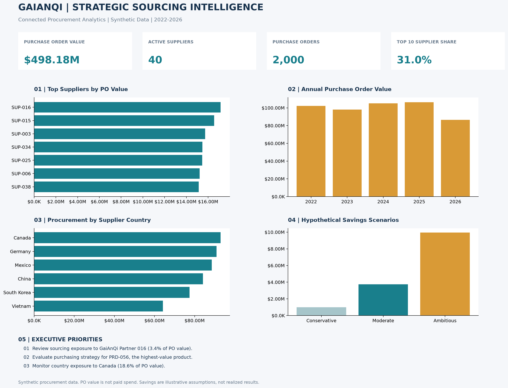

# Strategic Sourcing Intelligence

### GaiAnQi Global Trading | Connected Procurement Analytics

A Python-based procurement analytics project examining supplier concentration, purchasing patterns, geographic sourcing exposure, and hypothetical cost-optimization opportunities.

Built using **synthetic procurement data** shared with the [Global Trade Data Analysis](https://github.com/gkarnelle/Global-Trade-Data-Analysis) project.

## Executive Dashboard



## Executive Snapshot

| Metric | Result |
|---|---:|
| Purchase Order Value | $498.18M |
| Active Suppliers | 40 |
| Purchase Orders | 2,000 |
| Procurement Line Items | 5,000 |
| Top 10 Supplier Spend Share | 31.0% |
| Largest Supplier-Country Exposure | Canada, 18.6% |

*Metrics represent the current synthetic dataset and are not actual company results.*

## Business Questions

This project explores:

- Which suppliers account for the greatest share of procurement value?
- How concentrated is purchasing across the supplier base?
- Which countries represent the largest sourcing exposure?
- How does purchasing activity vary by year?
- Which products warrant sourcing strategy reviews?
- What savings might be possible under explicitly hypothetical scenarios?

## Connected Import Lifecycle

GaiAnQi Global Trading is a fictional importer used across three related portfolio projects.

**Strategic Sourcing Intelligence** → Supplier selection, procurement spend, purchase orders, and sourcing exposure.

**[Global Trade Data Analysis](https://github.com/gkarnelle/Global-Trade-Data-Analysis)** → Purchase order fulfillment, shipments, import operations, customs valuation, and compliance review indicators.

**Broker Entry Data Cleaning** → Broker-provided customs entry validation, reconciliation, and data-quality analysis.

Shared supplier, product, and purchase order identifiers support analysis across the import lifecycle.

## Analytics Outputs

The `outputs/` folder contains:

| Output | Purpose |
|---|---|
| `executive_summary.csv` | Executive procurement KPIs |
| `supplier_spend.csv` | Supplier purchasing value and concentration |
| `product_spend.csv` | Product-level procurement analysis |
| `country_spend.csv` | Supplier-country sourcing exposure |
| `annual_spend.csv` | Annual purchase order trends |
| `concentration_flags.csv` | Illustrative supplier concentration threshold |
| `savings_scenarios.csv` | Hypothetical cost-optimization scenarios |
| `sourcing_opportunities.csv` | Product-level sourcing review priorities |
| `executive_recommendations.csv` | Data-driven executive priorities |
| `sourcing_dashboard.png` | Executive visualization |

## Reproducible Workflow

The project uses Python, pandas, and Matplotlib.

1. `generate_data.py` retrieves the shared GaiAnQi supplier and purchase order datasets from Global Trade V2.
2. The script validates identifiers and reconciles purchase order totals.
3. `analyze.py` calculates sourcing KPIs, supplier concentration, geographic exposure, and hypothetical savings scenarios.
4. GitHub Actions automatically executes the workflow when relevant scripts change, with manual execution also supported.

To run locally:

```bash
pip install -r requirements.txt
python generate_data.py
python analyze.py
```

## Analytical Limitations

All company, supplier, purchasing, and transaction data are synthetic.

Purchase order value represents procurement commitments, not verified invoice payments or realized expenditure. Savings scenarios are illustrative assumptions, not guaranteed or realized savings. Supplier-country exposure is based on supplier master records and does not necessarily represent product country of origin.

This project demonstrates procurement analytics, data validation, cross-functional data integration, and executive reporting rather than operational results from a real importer.

## Version History

**V2:** Connected procurement analytics using shared GaiAnQi Global Trading data.

**V1:** Original standalone synthetic sourcing analytics, preserved in the repository's GitHub releases.
